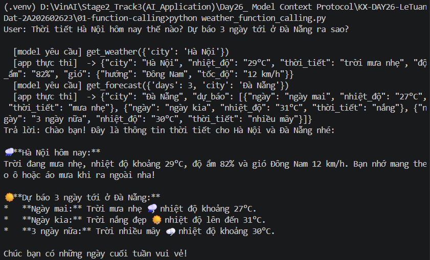
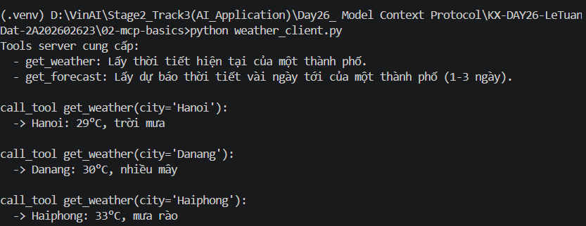
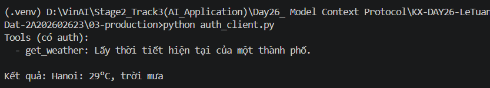
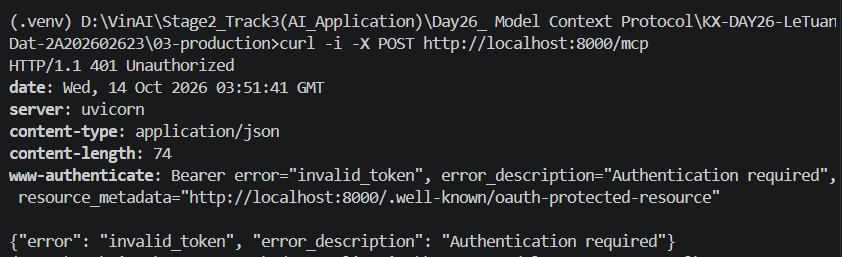
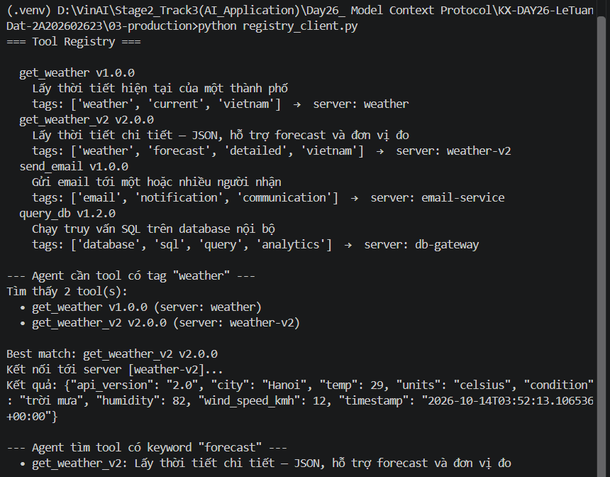
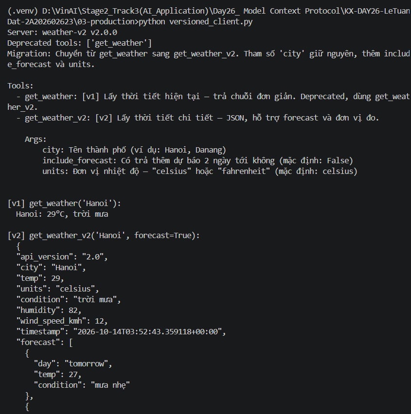
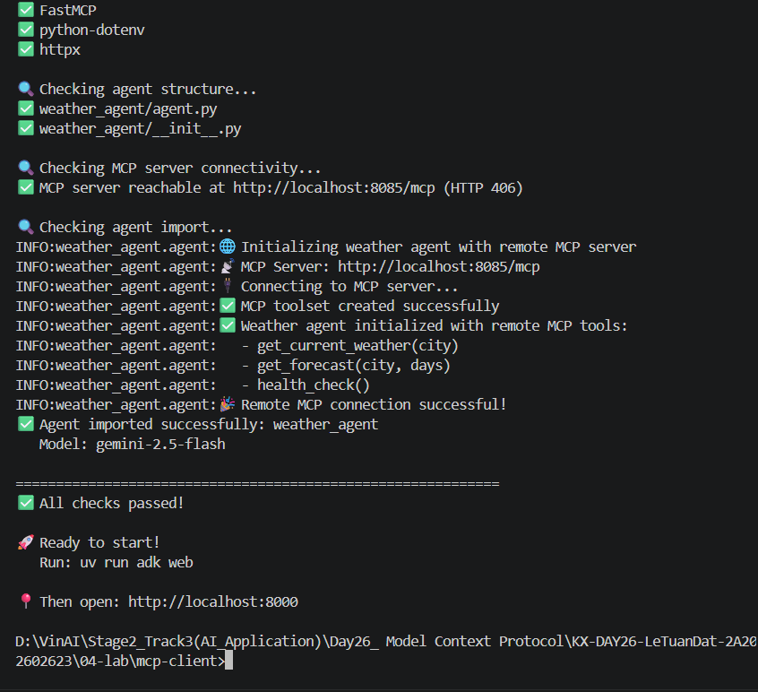
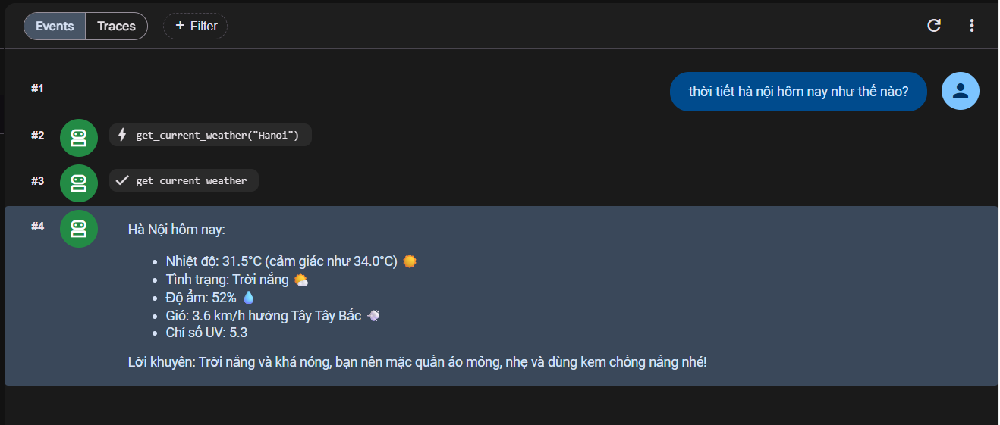
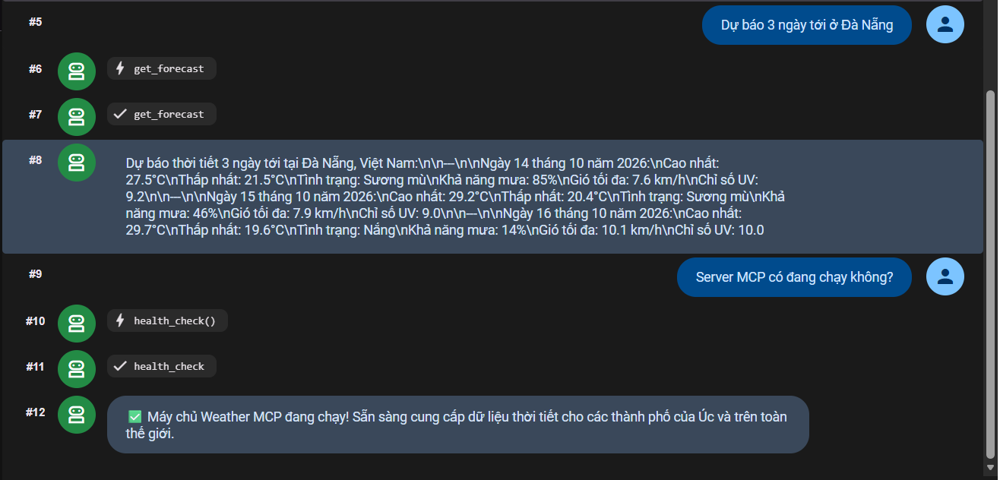

# Day 26 — Function Calling và MCP, giải thích cho người mới

File này giải thích toàn bộ bài Day 26 bằng ngôn ngữ đơn giản: mỗi khái niệm là gì, mỗi thư mục làm gì, mình đã sửa những gì, và cách chạy lại từ đầu trên Windows.

> Đọc theo thứ tự từ trên xuống. Mỗi phần chỉ cần hiểu phần trước nó.

---

## Mục lục

1. [Bức tranh tổng thể trong 1 phút](#1-bức-tranh-tổng-thể-trong-1-phút)
2. [Từ điển: các khái niệm cần biết](#2-từ-điển-các-khái-niệm-cần-biết)
3. [Bài 01 — Function Calling](#3-bài-01--function-calling)
4. [Bài 02 — MCP cơ bản](#4-bài-02--mcp-cơ-bản)
5. [Pain point: thêm tool `get_forecast`](#5-pain-point-thêm-tool-get_forecast)
6. [Bài 03 — MCP trong production](#6-bài-03--mcp-trong-production)
7. [Bài 04 — Lab: Agent ADK + MCP server thật](#7-bài-04--lab-agent-adk--mcp-server-thật)
8. [Những gì mình đã thay đổi trong repo](#8-những-gì-mình-đã-thay-đổi-trong-repo)
9. [Chạy lại toàn bộ từ đầu (Windows cmd)](#9-chạy-lại-toàn-bộ-từ-đầu-windows-cmd)
10. [Lỗi thường gặp và cách sửa](#10-lỗi-thường-gặp-và-cách-sửa)
11. [Tóm tắt để trả lời khi bị hỏi](#11-tóm-tắt-để-trả-lời-khi-bị-hỏi)

---

## 1. Bức tranh tổng thể trong 1 phút

Mô hình AI (LLM) như Gemini rất giỏi **nói**, nhưng **không biết gì về thế giới thật lúc này**: nó không biết hôm nay Hà Nội mưa hay nắng. Muốn nó trả lời được, ta phải cho nó **công cụ (tool)**, ví dụ một hàm `get_weather(city)`.

Có 2 ý tưởng cần phân biệt:

| | **Function Calling** | **MCP (Model Context Protocol)** |
|---|---|---|
| Nó là gì? | Một **khả năng của model**: biết "xin" gọi tool | Một **giao thức chuẩn** để kết nối app AI với tool |
| Ví dụ đời thường | Người biết **dùng** ổ cắm điện | **Chuẩn ổ cắm** chung cho mọi nhà |
| Ai chạy tool? | App của bạn tự chạy | Một **MCP server** riêng chạy |

**Điểm quan trọng nhất:** hai thứ này **không thay thế nhau**. MCP dùng Function Calling bên dưới:

```
Bạn hỏi: "Thời tiết Hà Nội?"
      │
      ▼
 LLM (Gemini) ──► dùng FUNCTION CALLING để quyết định: "gọi get_weather('Hanoi')"
      │
      ▼
 MCP Client ──── giao thức MCP ────► MCP Server (chạy hàm thật, trả kết quả)
      │
      ▼
 LLM đọc kết quả và viết câu trả lời: "Hà Nội 29°C, mưa, nhớ mang ô!"
```

---

## 2. Từ điển: các khái niệm cần biết

| Thuật ngữ | Giải thích dễ hiểu |
|---|---|
| **LLM** | Mô hình ngôn ngữ lớn (Gemini, Claude, GPT). Nhận chữ, trả chữ. |
| **Tool** | Một hàm Python mà AI có thể "nhờ" chạy, ví dụ `get_weather(city)`. |
| **Schema** | "Bản mô tả" của tool: tên, chức năng, cần tham số gì, kiểu gì. LLM đọc schema để biết cách gọi tool. |
| **Function Calling** | LLM trả về **một yêu cầu** dạng JSON như `get_weather(city="Hà Nội")`. **LLM không tự chạy hàm**, app mới chạy. |
| **MCP Server** | Chương trình **chứa và chạy** tool. Nó tự công bố "tôi có những tool này". |
| **MCP Client** | Chương trình **kết nối** tới server, hỏi danh sách tool (`list_tools`) và gọi tool (`call_tool`). |
| **`list_tools()`** | Client hỏi server: "Anh có tool gì?" Đây là bước **khám phá tool**. |
| **`call_tool()`** | Client nhờ server: "Chạy tool X với tham số Y giúp tôi." |
| **Transport** | "Đường dây" giữa client và server. **stdio**: cùng máy, client tự bật server. **HTTP**: qua mạng. |
| **Resource** | Dữ liệu chỉ để đọc mà server công bố (không phải hàm), ví dụ `server://info`. |
| **Bearer token** | Một "mật khẩu" gửi kèm request HTTP: `Authorization: Bearer <token>`. |
| **401 / 403** | 401 = chưa đăng nhập (thiếu token). 403 = có token nhưng không được phép. |
| **Deprecated** | "Lỗi thời": vẫn chạy được, nhưng khuyên chuyển sang bản mới. |
| **ADK** | Agent Development Kit của Google: bộ công cụ dựng **agent** (LLM + tool + vòng lặp tự động) kèm giao diện web. |
| **Agent** | LLM được trao tool và tự quyết định khi nào gọi tool nào để hoàn thành câu hỏi. |
| **venv** | Môi trường Python riêng cho dự án, để thư viện không lẫn với máy. |
| **uv** | Công cụ cài thư viện Python rất nhanh. Bài 04 dùng nó. |

---

## 3. Bài 01 — Function Calling

📁 [`01-function-calling/weather_function_calling.py`](01-function-calling/weather_function_calling.py)

**Ý tưởng:** mọi thứ nằm trong **một file app**. App tự viết schema, tự viết hàm, tự gọi Gemini và tự chạy hàm khi Gemini yêu cầu.

### Luồng chạy (5 bước)

```
① App viết SCHEMA bằng tay cho tool (tên, mô tả, tham số)
② App gửi câu hỏi + schema cho Gemini
③ Gemini trả về: "hãy gọi get_weather(city='Hà Nội')"   ← chỉ là JSON, Gemini KHÔNG chạy
④ App TỰ CHẠY hàm get_weather("Hà Nội") → "29°C, mưa"
⑤ App gửi kết quả lại cho Gemini → Gemini viết câu trả lời cuối
```

### 3 phần code cần nhìn

**Phần 1 — Schema viết tay.** Phải mô tả từng tham số, rất dài dòng:
```python
get_weather_declaration = types.FunctionDeclaration(
    name="get_weather",
    description="Lấy thời tiết hiện tại của một thành phố",
    parameters=types.Schema(
        type=types.Type.OBJECT,
        properties={"city": types.Schema(type=types.Type.STRING, description="Tên thành phố")},
        required=["city"],
    ),
)
```

**Phần 2 — Hàm thật** (dữ liệu giả lập):
```python
def get_weather(city: str) -> str:
    ...
```

**Phần 3 — Vòng lặp:** chừng nào Gemini còn yêu cầu gọi tool thì app chạy và gửi kết quả lại:
```python
while resp.function_calls:
    for fc in resp.function_calls:
        result = FUNCTIONS[fc.name](**fc.args)   # ← APP chạy, không phải model
    # gửi result lại cho Gemini...
```

### Kết quả



Nhìn vào ảnh: dòng `[model yêu cầu]` là **Gemini xin gọi tool**, còn dòng `[app thực thi]` là **app chạy hàm**. Gemini gọi 2 tool khác nhau vì câu hỏi có 2 ý.

---

## 4. Bài 02 — MCP cơ bản

📁 [`02-mcp-basics/weather_server.py`](02-mcp-basics/weather_server.py) và [`weather_client.py`](02-mcp-basics/weather_client.py)

**Ý tưởng:** tách tool ra **một server riêng**. Client không cần biết code bên trong; nó chỉ hỏi và nhờ.

```
weather_client.py                         weather_server.py
┌──────────────┐     giao thức MCP     ┌────────────────────┐
│ list_tools() │ ────────────────────▶ │ @mcp.tool()        │
│ call_tool()  │ ◀──────────────────── │ get_weather()      │
└──────────────┘        (stdio)        │ get_forecast()     │
                                       └────────────────────┘
```

### Server: khai báo tool chỉ bằng 1 decorator

```python
@mcp.tool()
def get_weather(city: str) -> str:
    """Lấy thời tiết hiện tại của một thành phố."""
    return f"{city}: ..."
```

`@mcp.tool()` **tự sinh schema**:
- `city: str` → tham số `city` kiểu string
- docstring `"""..."""` → mô tả tool

Không phải viết `FunctionDeclaration` dài dòng như bài 01.

### Client: không hard-code tool

```python
tools = await session.list_tools()                              # hỏi: có tool gì?
result = await session.call_tool("get_weather", {"city": "Hanoi"})   # nhờ chạy
```

Bài này **không cần API key**: nó chỉ minh hoạ tầng giao thức, chưa có LLM.

### Kết quả



Client in ra cả `get_forecast` dù **không ai sửa client**. Server có tool mới là client tự biết.

### Dùng lại ở nơi khác

Cùng server này có thể cắm vào Claude Code, Cursor, Gemini CLI... mà **không sửa dòng nào**:
```cmd
claude mcp add weather -- python "đường\dẫn\tới\weather_server.py"
```

---

## 5. Pain point: thêm tool `get_forecast`

Thầy yêu cầu: **define thêm function `get_forecast`** (dự báo vài ngày tới) ở cả hai cách, để thấy Function Calling vất vả hơn.

### Với Function Calling (bài 01): phải sửa 5 chỗ trong app

| # | Sửa gì | Vì sao |
|---|---|---|
| ① | Viết `get_forecast_declaration` (schema tay, ~15 dòng) | Gemini cần biết tool mới trông thế nào |
| ② | Thêm vào danh sách `TOOLS` | Nếu quên, Gemini không thấy tool |
| ③ | Viết hàm `get_forecast()` | App phải có hàm thật để chạy, và **phải khớp** với schema ① |
| ④ | Thêm bảng `FUNCTIONS = {"get_weather": ..., "get_forecast": ...}` | Để biết tên tool nào ứng với hàm nào |
| ⑤ | Sửa vòng lặp: `get_weather(**fc.args)` → `FUNCTIONS[fc.name](**fc.args)` | Code cũ **luôn** gọi `get_weather`, dù Gemini xin tool nào |

### Với MCP (bài 02): sửa đúng 1 chỗ trên server

```python
@mcp.tool()
def get_forecast(city: str, days: int = 3) -> str:
    """Lấy dự báo thời tiết vài ngày tới của một thành phố (1-3 ngày)."""
    ...
```

Client **không sửa gì**.

### Vì sao đây là "pain point"?

```
Function Calling:                          MCP:
  App A: sửa 5 chỗ                           Server: thêm 1 hàm
  App B: copy & sửa lại 5 chỗ                App A, B, C: không đổi
  App C: copy & sửa lại 5 chỗ                (tự khám phá qua list_tools)
  → Schema dễ lệch với hàm thật
  → Đổi sang OpenAI/Claude = viết lại schema theo format khác
```

---

## 6. Bài 03 — MCP trong production

📁 [`03-production/`](03-production/)

Chạy trên máy cá nhân thì đơn giản, nhưng khi đưa vào hệ thống thật cần giải quyết 3 việc:

| Vấn đề | Câu hỏi | Giải pháp trong bài |
|---|---|---|
| **3a. Auth** | Ai được phép gọi tool? | Bearer token |
| **3b. Registry** | Agent tìm tool ở đâu khi có hàng trăm tool? | Danh mục tool trung tâm |
| **3c. Versioning** | Nâng cấp tool mà không làm hỏng client cũ? | Chạy v1 và v2 song song |

### 3a. Authentication

- Server chạy qua **HTTP** (`http://localhost:8000/mcp`), không phải stdio, nên ai trên mạng cũng có thể gọi. Vì vậy cần kiểm tra token.
- [`auth_server.py`](03-production/auth_server.py): class `StaticTokenVerifier` kiểm tra token có nằm trong danh sách hợp lệ không.
- [`auth_client.py`](03-production/auth_client.py): gửi kèm header `Authorization: Bearer dev-token-abc123`.
- Hàm `get_weather` **không biết gì về auth**: SDK xử lý ở tầng ngoài.

| Có token đúng ✅ | Không có token ❌ |
|---|---|
|  |  |

### 3b. Tool Registry

[`registry.json`](03-production/registry.json) giống một **danh bạ tool**: mỗi tool có tag, mô tả, version và nằm ở server nào.

```
Agent: "tôi cần tool có tag 'weather'"
   │
   ▼
Registry: get_weather v1.0 và get_weather_v2 v2.0
   │
   ▼
Agent chọn best match: version cao nhất, không deprecated → get_weather_v2
   │
   ▼
Tự kết nối đúng server (weather-v2) và gọi tool
```

`send_email` và `query_db` chỉ là **ví dụ** trong danh bạ; server của chúng không tồn tại nên không bao giờ được gọi.



### 3c. Versioning

[`versioned_server.py`](03-production/versioned_server.py) dùng 3 kỹ thuật:

1. **Tool mới song song:** `get_weather_v2` tồn tại **bên cạnh** `get_weather`, không xoá tool cũ.
2. **Tham số tuỳ chọn:** `include_forecast=False`, `units="celsius"` có giá trị mặc định, nên client cũ gọi `get_weather_v2(city="Hanoi")` vẫn chạy.
3. **Metadata:** resource `server://info` cho client biết version hiện tại, tool nào deprecated và cách chuyển đổi.



---

## 7. Bài 04 — Lab: Agent ADK + MCP server thật

📁 [`04-lab/`](04-lab/)

Đây là bài **ghép tất cả lại**: dữ liệu thời tiết **thật**, LLM **thật**, giao diện web.

```
 Trình duyệt          ADK Agent              MCP Server              WeatherAPI.com
 localhost:8000  ──►  (mcp-client)  ──HTTP──► (mcp-server)  ──REST──►  (dữ liệu thật)
                      Gemini 2.5 Flash        localhost:8085/mcp
```

### Hai thư mục

| Thư mục | Vai trò | File chính |
|---|---|---|
| `mcp-server/` | MCP server có 3 tool: `get_current_weather`, `get_forecast`, `health_check`. Gọi WeatherAPI thật. | [`weather.py`](04-lab/mcp-server/weather.py) |
| `mcp-client/` | Agent ADK kết nối tới server qua `McpToolset` | [`weather_agent/agent.py`](04-lab/mcp-client/weather_agent/agent.py) |

### ADK làm gì cho mình?

So với bài 01 (tự viết vòng lặp) và bài 02 (tự gọi `list_tools`/`call_tool`), ADK **làm hết tự động**:

1. Kết nối tới MCP server
2. Gọi `list_tools` để biết có 3 tool
3. Đưa danh sách tool cho Gemini
4. Chạy vòng function calling: Gemini chọn tool → ADK gọi server → đưa kết quả lại cho Gemini
5. Cung cấp giao diện chat ở `http://localhost:8000`

Phần code của mình chỉ còn khoảng 10 dòng:
```python
weather_tools = McpToolset(connection_params=StreamableHTTPConnectionParams(url=MCP_SERVER_URL))
root_agent = Agent(name="weather_agent", model="gemini-2.5-flash", instruction="...", tools=[weather_tools])
```

### Kết quả

| Kiểm tra setup | Thời tiết hiện tại |
|---|---|
|  |  |



Trong giao diện: dòng ⚡ `get_current_weather("Hanoi")` là **Gemini xin gọi tool** (Function Calling), còn dòng ✓ là **MCP server trả kết quả**. Hai cơ chế chạy cùng nhau, đúng như sơ đồ ở phần 1.

---

## 8. Những gì mình đã thay đổi trong repo

| File | Thay đổi | Lý do |
|---|---|---|
| [`01-function-calling/weather_function_calling.py`](01-function-calling/weather_function_calling.py) | Thêm `get_forecast_declaration`, hàm `get_forecast`, bảng `FUNCTIONS`; sửa vòng lặp; đổi câu hỏi test | Bài tập "define get_forecast", để thấy pain point của Function Calling |
| [`02-mcp-basics/weather_server.py`](02-mcp-basics/weather_server.py) | Thêm 1 hàm `@mcp.tool() get_forecast` | So sánh: MCP chỉ cần 1 chỗ |
| [`04-lab/mcp-client/weather_agent/agent.py`](04-lab/mcp-client/weather_agent/agent.py) | Thêm `instruction=` cho Agent | Trước đó Gemini chép nguyên chuỗi `\n` của tool; giờ trả lời có định dạng, emoji, lời khuyên |
| [`screenshots/`](screenshots/) | 9 ảnh kết quả | Yêu cầu nộp bài |
| `HUONG_DAN_NEWBIE.md` | File này | Giải thích cho người mới |

---

## 9. Chạy lại toàn bộ từ đầu (Windows cmd)

> README gốc viết lệnh cho Linux/macOS (`export`, `source`). Trên Windows **cmd** dùng `set` và `activate` như dưới đây.

### Bước 0 — Cài đặt (1 lần)

```cmd
cd /d "D:\VinAI\Stage2_Track3(AI_Application)\Day26_ Model Context Protocol\KX-DAY26-LeTuanDat-2A202602623"
python -m venv .venv
.venv\Scripts\activate
set PYTHONUTF8=1
pip install -r requirements.txt
pip install uv
```

Cần 2 API key:
- **Gemini:** https://aistudio.google.com/apikey
- **WeatherAPI** (chỉ bài 04): https://www.weatherapi.com

> Mỗi khi mở cửa sổ cmd mới: chạy `.venv\Scripts\activate` và `set PYTHONUTF8=1`.

### Bước 1 — Bài 01

```cmd
cd 01-function-calling
set GEMINI_API_KEY=key_gemini
python weather_function_calling.py
```

### Bước 2 — Bài 02 (không cần key)

```cmd
cd ..\02-mcp-basics
python weather_client.py
```

### Bước 3 — Bài 03

```cmd
cd ..\03-production
python auth_server.py
```
Mở **cửa sổ cmd thứ 2** (activate venv, `cd` vào `03-production`):
```cmd
python auth_client.py
curl -i -X POST http://localhost:8000/mcp
```
Tắt server ở cửa sổ 1 (`Ctrl+C`), rồi chạy:
```cmd
python registry_client.py
python versioned_client.py
```

### Bước 4 — Bài 04 (2 cửa sổ)

**Cửa sổ 1 — server:**
```cmd
deactivate
cd 04-lab\mcp-server
uv sync
set PYTHONUTF8=1
set WEATHERAPI_KEY=key_weatherapi
uv run python weather.py
```

**Cửa sổ 2 — agent:**
```cmd
cd 04-lab\mcp-client
uv sync
echo GOOGLE_API_KEY=key_gemini> .env
set PYTHONUTF8=1
uv run python verify_setup.py
uv run adk web
```
Mở http://127.0.0.1:8000, chọn `weather_agent`, rồi hỏi "Thời tiết Hà Nội bây giờ thế nào?".

---

## 10. Lỗi thường gặp và cách sửa

| Lỗi | Nguyên nhân | Cách sửa |
|---|---|---|
| `UnicodeDecodeError ... cp1252` khi `pip install` | Windows đọc file tiếng Việt sai bảng mã | `set PYTHONUTF8=1` rồi cài lại |
| `UnicodeEncodeError` khi in tiếng Việt/emoji | Như trên | `set PYTHONUTF8=1` |
| `The filename, directory name... is incorrect` | Gõ lệnh PowerShell (`$env:...`) trong cmd | Trong cmd dùng `set TEN=giatri` |
| `403 PERMISSION_DENIED ... IP address restriction` | API key bị giới hạn IP | Tạo key mới trong AI Studio, hoặc gỡ giới hạn trong Google Cloud Console |
| `No module named mcp.server.mcpserver` | Chưa activate venv hoặc cài nhầm `mcp` 1.x | `.venv\Scripts\activate` rồi `pip install -r requirements.txt` |
| `address already in use` cổng 8000 | `auth_server.py` và `adk web` cùng dùng cổng 8000 | Tắt cái đang chạy (`Ctrl+C`) |
| Agent trả lời nhưng **không gọi tool** | MCP server (cổng 8085) chưa chạy | Bật `weather.py` rồi khởi động lại `adk web` |
| Tool trả `WeatherAPI key not configured` | Đặt key sai cửa sổ | `set WEATHERAPI_KEY=...` **ở cửa sổ chạy server** |
| Cảnh báo `VIRTUAL_ENV ... does not match` | Venv gốc đang bật khi chạy `uv` | Vô hại; gõ `deactivate` để hết cảnh báo |
| Câu trả lời có chuỗi `\n` | Agent không có hướng dẫn định dạng | Đã sửa bằng `instruction=` trong `agent.py` |

---

## 11. Tóm tắt để trả lời khi bị hỏi

**"Function Calling và MCP khác nhau thế nào?"**
> Function Calling là **khả năng của model**: model sinh ra yêu cầu gọi tool dạng JSON, còn app tự chạy hàm. MCP là **giao thức chuẩn** giữa client và server: server tự công bố tool, và mọi client dùng chung được. MCP **dùng Function Calling bên dưới**, nên hai cái bổ sung cho nhau chứ không thay thế nhau.

**"Pain point của Function Calling là gì?"**
> Mỗi tool mới phải viết schema bằng tay, viết hàm, và sửa vòng lặp chọn hàm. Với `get_forecast`, mình phải sửa 5 chỗ ở bài 01 nhưng chỉ 1 chỗ ở bài 02. Mỗi app dùng tool đó lại phải lặp lại, schema dễ lệch với hàm thật, và đổi nhà cung cấp model thì phải viết lại schema.

**"Đưa MCP vào production cần gì?"**
> Auth (bearer token, OAuth), Tool Registry để agent tìm tool theo tag, Versioning (v1/v2 song song, tham số tuỳ chọn, metadata deprecated). Ngoài ra còn health check, logging và tracing.

**"ADK giúp gì?"**
> ADK đóng vai trò MCP client: tự `list_tools`, đưa tool cho Gemini, chạy vòng function calling và có sẵn giao diện web. Mình chỉ cần khai báo URL của server và tạo `Agent`.
